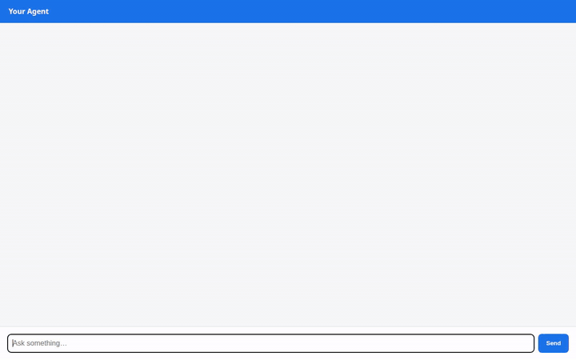

# ChefPro AI

An expert AI culinary assistant specializing in authentic Hyderabadi and Telangana cuisine, built with the Google Agent Development Kit (ADK) and Gemini 3.8 Flash. ChefPro AI helps home cooks discover traditional regional recipes from ingredients they already have in their pantry, generates smart grocery shopping lists for missing ingredients, and manages favorite recipes with persistent storage.



---

## What ChefPro AI Does

- **Pantry-Based Recipe Discovery**: Matches on-hand ingredients (e.g., rice flour, roasted peanuts, onions, tamarind) against an authentic catalog of Telangana and Hyderabadi dishes to suggest what you can cook right away.
- **Regional Culinary Technique Guidance**: Explains traditional methods such as Dum cooking, balancing fiery Telangana spice with sour tamarind and jaggery, and tempering techniques for pacchi pulusu.
- **Smart Grocery Shopping Lists**: Compares full recipe requirements against pantry items already on hand, extracts the missing ingredients, and stores the shopping list to Firestore.
- **Recipe Management & Favorites**: Allows cooks to bookmark favorite dishes, retrieve saved favorites, and store customized creations.

---

## Architecture & Wired Services

### Active Cloud Services & Components

| Component / Service | Implementation Status | Description |
| ------------------- | --------------------- | ----------- |
| **Gemini 3.8 Flash** | **Wired & Active** | Core reasoning model configured via ADK (`google.adk.agents.Agent`) with HTTP retry options. |
| **Google Cloud Firestore** | **Wired & Active** | Persistent NoSQL database storing the recipe catalog (`recipes` collection) and saved shopping lists (`shopping_lists` collection). |
| **FastAPI Chat Frontend** | **Wired & Active** | Lightweight web interface communicating with the agent runtime via the Agent-to-Agent (A2A) protocol (`a2a-sdk`). |
| **Agent Runtime / Reasoning Engine** | **Wired & Active** | Deployed backend agent runtime on Vertex AI (`us-east1`). |

### Function Tools

All tools are implemented in [`app/tools.py`](app/tools.py) and registered on the root agent in [`app/agent.py`](app/agent.py):

- `search_recipes`: Queries Firestore with keyword and cuisine filters to find matching dishes.
- `get_recipe_details`: Retrieves full step-by-step instructions and ingredient lists for a specified dish.
- `create_shopping_list`: Analyzes missing ingredients against on-hand pantry items and saves the grocery list to Firestore.
- `save_recipe`: Stores a new or customized recipe directly into Firestore.
- `list_favorites`: Queries all recipes marked with `is_favorite: True`.
- `set_favorite_status`: Updates bookmark/favorite status of any dish.

---

## Planned Capabilities (Not Yet Implemented)

The following features were scoped in the initial brief but have not yet been implemented in the active agent code:

- **Vertex AI Memory Bank**: Cross-session long-term memory for remembering user spice tolerance and pantry staple defaults across conversations. *(Planned, not yet implemented)*
- **Imagen Visual Dish Generation**: Generating plating previews and dish presentations with Cloud Storage persistence. *(Planned, not yet implemented)*
- **A2UI Rich Component Responses**: Emitting structured A2UI cards/carousels natively from the agent callback. *(Planned, not yet implemented)*

---

## Project Structure

```
├── app/
│   ├── agent.py               # Root ADK agent definition & prompt instructions
│   ├── tools.py               # Firestore database tools (search, shopping list, favorites)
│   ├── fast_api_app.py        # Local FastAPI dev server
│   └── app_utils/             # Agent runtime helpers
├── frontend/
│   ├── main.py                # FastAPI proxy connecting to agent via A2A protocol
│   ├── static/                # Chat UI assets (HTML, CSS, JS)
│   └── Dockerfile             # Container configuration for Cloud Run
├── seed_firestore.py          # Script to populate Firestore with authentic recipes
├── agents-cli-manifest.yaml   # Agent deployment manifest
├── demo.gif                   # Recorded interactive demo GIF
└── pyproject.toml             # Python dependencies (google-adk, google-cloud-firestore)
```

---

## Setup & Running Locally

### 1. Prerequisites

- Python 3.11+
- Google Cloud SDK (`gcloud`) authenticated to a GCP project with Firestore enabled
- `uv` package manager

### 2. Authentication & Environment

Set your Google Cloud project and log in with Application Default Credentials:

```bash
gcloud config set project YOUR_PROJECT_ID
gcloud auth application-default login
```

### 3. Install Dependencies & Seed Database

```bash
# Install agent dependencies
uv sync

# Populate Firestore with initial Hyderabadi & Telangana recipes
uv run python seed_firestore.py
```

### 4. Run the Agent Locally

Start the ADK development playground:

```bash
uv run agents-cli playground
```

### 5. Run the Chat Frontend

In a separate terminal, run the local FastAPI chat proxy:

```bash
cd frontend
python3 -m venv .venv
source .venv/bin/activate
pip install -r requirements.txt

# Run the frontend server
export AGENT_ENGINE_RESOURCE_NAME="projects/YOUR_PROJECT_ID/locations/us-east1/reasoningEngines/YOUR_ENGINE_ID"
export AGENT_DIRECTORY="app"
export PORT=8080
python main.py
```
